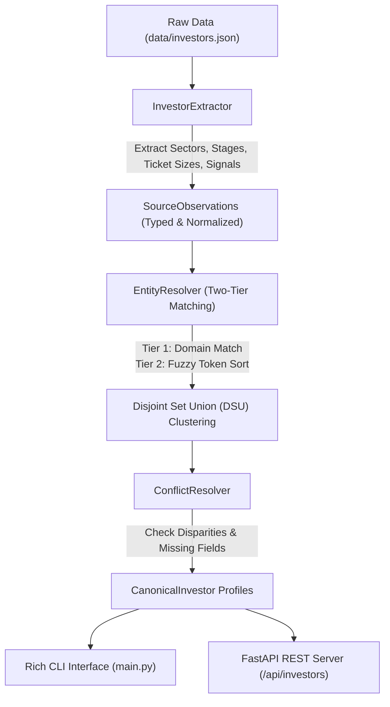

# Investor Intelligence Engine

A production-grade prototype that ingests unstructured investor notes and multi-source directory records, extracts structured attributes, performs entity deduplication using fuzzy heuristics and graph clustering, and flags source conflicts with full provenance tracking.


## Core Features

- **Robust Extraction Pipeline**: Parses unstructured text and metadata to extract investment focus (sectors), venture stages, structured ticket sizes (with currency normalization), target geographies, and momentum signals (portfolio companies, fund sizes, leadership).
- **Two-Tier Entity Resolution**: Combines deterministic domain canonicalization with token-sort fuzzy matching and Disjoint Set Union (Union-Find) graph clustering. Includes guards against single-token false positives (e.g. keeps *"Horizon Ventures"* distinct from *"Apex Horizon Ventures"*).
- **Conflict Detection & Evidence Provenance**: Retains all underlying observations per entity. Detects discrepancies in ticket sizes (e.g. \$1.5M vs \$5M), geographic headquarters, and stage divergence, assigning severity levels and suggested actions.
- **Completeness & Status Scoring**: Explicitly detects missing fields (e.g. missing ticket size, missing website) and tags canonical entities with statuses (`VERIFIED_MULTI_SOURCE`, `CONFLICT_DETECTED`, `SINGLE_SOURCE_UNVERIFIED`, `INCOMPLETE_PROFILE`).
- **Dual Interface (CLI + REST API)**: Clean, color-coded CLI with Rich tables, detailed inspection, and query filtering, alongside an interactive FastAPI service with automated Swagger documentation.
- **Comprehensive Test Suite**: 17 unit and integration tests covering extraction edge cases, fuzzy matching, conflict flags, and API endpoints.


### Technical approach
The project uses a deterministic data-processing pipeline rather than an opaque AI-only workflow. It starts by normalizing raw investor records into typed Pydantic models, then extracts venture-stage, sector, geography, ticket-size, and signal fields with regex-based parsing and controlled taxonomies. After extraction, it resolves duplicate entities using a two-stage strategy: exact domain matching first, then RapidFuzz name similarity with a Union-Find clustering step to merge transitive matches. Finally, it compares conflicting source observations and preserves provenance so each canonical investor profile can show where a fact came from and why it was flagged.

### Assumptions
This prototype assumes that input records are investor directory and note-style data with enough name, website, and text clues to support entity matching. It also assumes domain-specific vocabularies (e.g., venture stages and sectors) are sufficient for a controlled, explainable system, and that financial figures can be normalized using a small set of exchange-rate conversions to USD for comparison.

### Limitations
The system is intentionally lightweight and is designed for a quick, explainable prototype rather than a production-grade intelligence platform. It does not yet use a persistent database, vector search, web crawling, or external LLM-based semantic extraction. As a result, it may miss nuanced language in long narratives, struggle with ambiguous names and edge-case legal entities, and rely on heuristic thresholds for fuzzy matching and conflict detection. Currency conversion is approximate and the output remains bounded by the curated taxonomies supplied in code.

### Test results
The project currently passes a focused automated validation suite: 17 unit and integration tests cover extraction quality, fuzzy deduplication, false-positive protection, conflict detection, missing-field tracking, and FastAPI endpoint behavior. On the bundled synthetic dataset, the engine reduces 10 raw records to 6 canonical investor profiles, a 40% deduplication rate, while preserving conflict evidence and status labels for downstream review.

---

## System Architecture



### 1. Extraction Pipeline
- **Ticket Sizes**: Parses complex ranges and single checks (`$1.5M - $3M`, `$1,500,000 to $3,000,000`, `€500,000 to €2,000,000`, `$500k`, `checks of $2M to $4M`). Normalizes currencies (EUR, GBP) to USD estimates while preserving the original raw string.
- **Sectors & Stages**: Matches keywords against venture lifecycle taxonomies (`Pre-Seed` through `Growth`) and sector groupings (`FinTech`, `B2B SaaS`, `ClimateTech`, `DeepTech`, `AI/ML`, etc.).
- **Signals**: Extracts fund sizes (e.g. `"$250M Fund IV"`), portfolio companies (e.g. `"PayStacker"`), and key leadership (e.g. `"Sarah Chen"`).

### 2. Entity Resolution & Deduplication
- **Tier 1 (Domain)**: Cleans URLs into root hostnames (`https://www.apexhorizon.vc/europe` $\rightarrow$ `apexhorizon.vc`). Exact domain matches trigger immediate merge with 98% confidence.
- **Tier 2 (Fuzzy Name)**: Strips punctuation and legal stopwords (`LLC`, `Ventures`, `Partners`, `Fund`, `Capital`, `VC`). Uses RapidFuzz token sorting ratio ($\ge 88\%$).
- **False-Positive Safeguards**: Enforces single-token mismatch guards to prevent short generic names from over-clustering (e.g. *"Horizon"* does **not** match *"Apex Horizon"*).
- **Union-Find Clustering**: Groups matched pairs into transitive clusters.

### 3. Conflict Resolution & Source Tracking
- **Provenance Retention**: Each canonical profile stores an array of all contributing `SourceObservation`s with source IDs, timestamps, and confidence scores.
- **Conflict Evaluation**:
  - **Ticket Size**: Flags discrepancy if source check ranges are disjoint or diverge by $> 2.0\times$ (Severity: `HIGH`).
  - **Geography**: Flags discrepancy if multiple sources claim distinct headquarters (Severity: `MEDIUM`).
  - **Stage Divergence**: Flags discrepancy if one source reports early-stage only while another reports late-stage/growth only (Severity: `MEDIUM`).
- **Canonical Synthesis**: Merges non-conflicting fields, highlights primary HQ and blended ranges, tags `missing_fields`, and assigns an audit status.

---

---

## Quick Start & CLI Usage

### Installation
Ensure Python 3.11+ is installed:
```bash
# Clone or navigate to the directory
cd "Investor Intelligence Engine"

# Install dependencies
pip install -r requirements.txt
```
---

## FastAPI REST Service

Start the web service:
```bash
python main.py serve --port 8000
```
Open **`http://127.0.0.1:8000/docs`** in your browser to access the interactive Swagger UI.

### Key API Endpoints
- `GET /health`: Service health and entity counts.
- `GET /api/investors`: Query resolved profiles with filter params (`q`, `sector`, `stage`, `conflicts_only`).
- `GET /api/investors/{id}`: Detailed entity view with source observations and conflict reports.
- `GET /api/stats`: Deduplication and conflict metrics.
- `POST /api/extract`: Ingest and parse arbitrary raw text snippet into structured profile.

---

## Running Tests

Execute the comprehensive test suite with pytest:
```bash
python -m pytest tests -v
```


#
```

---

## CI/CD Workflow

The `.github/workflows/ci.yml` pipeline automatically executes on every push and pull request to `main`:
1. Matrix tests across Python **3.11** and **3.12**.
2. Installs dependencies and runs `ruff` syntax/linting checks.
3. Runs all 17 unit and integration tests with `pytest`.
4. Verifies CLI operations (`run`, `query`, `filter`, `export`).

---
